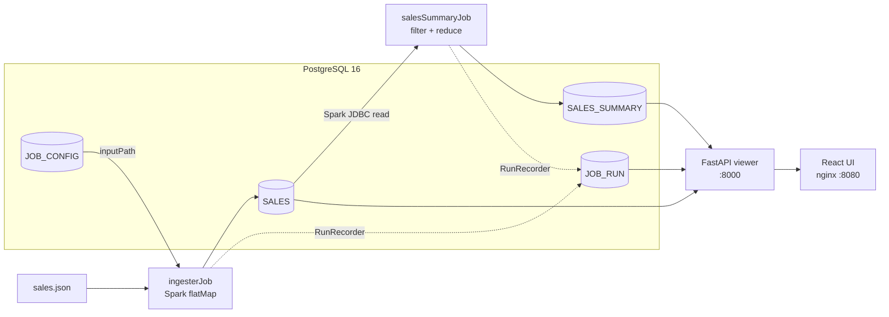
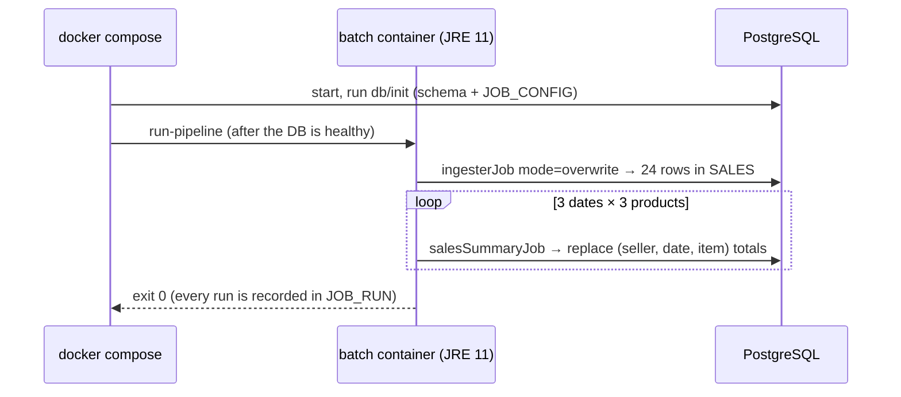

# ⚡ Java Spark Batch Application

<p align="center"></p>

**A Spark (Java API) batch template, now running end to end with one command, with run history you can see.**

`docker compose up` → PostgreSQL → **Spark ingestion job** (JSON → `SALES`) → **9 Spark summary jobs** (per seller, date and product → `SALES_SUMMARY`) → a read-only **FastAPI + React** viewer on `:8080` that shows every run and checks Spark's totals against plain SQL.


---

## 1. The project

This is a template from the *Apache Spark for Java Developers* course ([original README](docs/ORIGINAL_README.md)). It's a Spring Boot command-line app where each job follows the **Reader → Processor → Writer** pattern on Spark:

| Job | Reads | Spark work | Writes |
|---|---|---|---|
| `ingesterJob` | `data/ingestion/sales.json` (path from the `JOB_CONFIG` table) | `flatMap` explodes nested seller → day → items into rows | `SALES` |
| `salesSummaryJob` | `SALES` through Spark JDBC, filtered by `sellerId`, `date` and `product` | `filter` + `reduce` per seller | `SALES_SUMMARY` |

Originally it only ran inside the course sandbox (`legacy/input.sh`), against an in-memory H2 database that disappeared after each run.

## 2. Architecture

<p align="center"></p>





## 3. Quick start

```bash
cp .env.example .env          # local-only defaults, no secrets
docker compose up -d --build  # db + batch (runs once, then exits) + api + frontend
open http://localhost:8080
docker compose logs batch     # Spark output for each job
```

Run one job yourself (it shows up in the run history):

```bash
docker compose run --rm batch jobName=salesSummaryJob sellerId=Joe,Beth date=20201111000000 product=Beer
docker compose run --rm batch      # re-run the whole pipeline (idempotent)
docker compose down                # add -v to reset the database
```

Without Docker (JDK 11 + Maven): `mvn test` runs every job on local Spark against in-memory H2.

## 4. Real results

The screenshots and samples below come from the stack running on this branch. The data is the sample sales file that came with the original course project.

| Run history | |
|---|---|
|  | **12 runs:** 1 ingestion + 9 summaries from the pipeline, 1 manual re-run (same totals, no duplicates), and 1 deliberately invalid date (`2020-13-45`), recorded as **FAILED** with its error message. All **19/19** Spark totals match `SUM(quantity)` computed directly in SQL. Each job takes about 2 seconds on local Spark. |

```json
GET /api/runs?limit=1
{ "job_name": "salesSummaryJob", "params": "jobName=salesSummaryJob sellerId=Joe date=2020-13-45 product=Beer",
  "status": "FAILED", "error": "IllegalArgumentException: Invalid date '2020-13-45' (expected yyyyMMddHHmmss or yyyy-MM-dd)" }
```

More samples are in [docs/screenshots/api-samples.json](docs/screenshots/api-samples.json).

## 5. Viewer API (read-only, no auth)

| Endpoint | Returns |
|---|---|
| `GET /health` | DB status plus row counts (`degraded` if Postgres is unreachable) |
| `GET /api/runs?limit=` | `JOB_RUN`: job, parameters, status, rows written, duration, error |
| `GET /api/sales` | the ingested `SALES` rows |
| `GET /api/summary` | `SALES_SUMMARY`, with a `sql_total` and a `matches` flag for each row |

## 6. What changed on this branch

**Running it**
- Multi-stage `Dockerfile`: Maven build, then a JRE 11 image that runs on an exploded classpath.
- `docker/run-pipeline.sh` runs the whole pipeline, or one job when you pass arguments.
- `docker-compose.yml` brings up Postgres, the batch job, the API and the UI, using **PostgreSQL** in place of throwaway H2. H2 is still the default for `mvn test`.
- The Java build moved from 1.8 to **11**.

**Bugs fixed**
- The writers always reported **0 rows**, because the partition mappers returned an iterator they had already used up.
- `salesSummaryJob` **crashed** when a seller had no sales for the date/product, because `reduce` ran on an empty Dataset.
- The SQL relied on H2-only `PARSEDATETIME`. It now uses portable `DATE 'yyyy-mm-dd'`, and the date is checked in Java first.
- Quotes in parameters are escaped, so a value can't break out of the SQL string.
- Spark JDBC column names are upper-cased, because PostgreSQL returns them in lower case and `Row.getAs` is case-sensitive.
- A new connection pool was created on every partition. There's now one per JVM.
- The app crashed when started without `jobName=` (which also broke `contextLoads`). It now prints usage and exits.
- The process didn't exit after Spark finished. It now stops the session and exits with the right code.

**New features**
- `JOB_RUN` run history, written by `RunRecorder`, with rows written from `JobMetrics`.
- `mode=overwrite` for ingestion, and idempotent summaries, so re-running doesn't double count.
- Spark settings for small local jobs: 4 shuffle partitions and no Spark UI port.

**Tests**
- **10 JUnit tests**, including an end-to-end pipeline test on real local Spark.
- The commented-out reducer test was moved from `src/main` to `src/test` and switched back on.
- 3 pytest tests for the viewer.
- CI runs the Maven tests, the viewer tests and the frontend build, then `docker compose build`.

**Moves, no deletes**
- `README.md` → `docs/ORIGINAL_README.md`
- `input.sh` → `legacy/`
- the committed `target/` build output → `legacy/target-committed-build-output/`

**Config**
- `.env.example` holds local defaults only.
- There's no `PRODUCTIONIZING.md`, because the repo has no notebooks.
